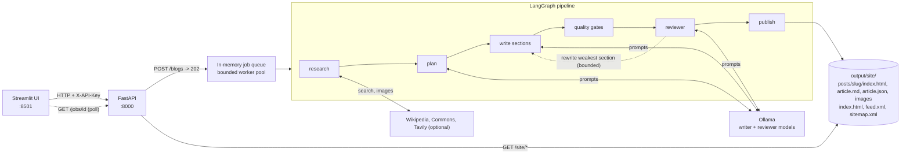

# Come-Blog

A local-first blog generator. Give it a topic and it researches, plans, writes,
reviews and publishes a real blog post: designed HTML page, cited sources with
links, licensed images with credits, RSS, sitemap and a Markdown export. The
models run on your machine through Ollama.

## What you get per post

| File | Purpose |
|---|---|
| `index.html` | The article page: table of contents, reading progress, dark mode, print styles, SEO and JSON-LD |
| `article.md` | Portable Markdown with citations as real links |
| `article.json` | Full data: sections, sources, quality report, every writing pass |
| `cover.svg` / `image-N.jpg` | Generated cover art and/or downloaded open-licensed photos with credit lines |

The site lives in `output/site/` (`index.html` card grid, `feed.xml`, `sitemap.xml`)
and is plain static files, so it can be hosted anywhere.

## How it works

```
research -> plan -> write sections -> quality gates -> reviewer -> publish
                         ^                                  |
                         +---- rewrite failing sections <---+  (bounded)
```

See [`docs/production/`](docs/production/) for the design notes and measured results.

## Architecture



The API accepts a job and returns immediately; a worker runs the pipeline and the UI polls
for progress. Everything the pipeline produces is plain files under `output/`, which the API
also serves at `/site/`.

## Setup

Requires Python 3.11+ and [Ollama](https://ollama.com).

```bash
ollama pull qwen2.5:3b      # writer
ollama pull qwen3:4b        # reviewer

cd backend
python -m venv .venv
.venv\Scripts\activate       # PowerShell; use source .venv/bin/activate on macOS/Linux
pip install -e ".[dev]"
cd ../ui && pip install -r requirements.txt
```

Copy `.env.example` to `.env` and set at least:

- `COMEBLOG_CONTACT` - a URL or email. **Required** for Wikipedia/Commons: Wikimedia
  blocks clients that do not identify themselves.
- `COMEBLOG_TAVILY_API_KEY` - optional, adds current web results.

## Run

```bash
cd backend && uvicorn app.main:app --port 8000     # API + the published site
cd ui && streamlit run streamlit_app.py            # create and manage posts
```

- Create posts in Streamlit (http://localhost:8501), pick length, tone and audience.
- Read the blog at http://localhost:8000/site/index.html.

Generation on small CPU-bound models takes minutes; the UI shows live progress.

## Docker

```bash
cp .env.example .env            # set COMEBLOG_CONTACT at least
docker compose up --build
# first run only: pull the models into the Ollama volume
docker compose exec ollama ollama pull qwen2.5:3b
docker compose exec ollama ollama pull qwen3:4b
```

Three services start: `ollama` (models persisted in the `ollama` volume), `api` on
http://localhost:8000 and `ui` on http://localhost:8501. Generated posts live in the `output`
volume. Both app images are multi-stage `python:3.12-slim` builds that run as a non-root user.
Ollama runs on CPU by default; GPU passthrough needs extra compose settings for your platform.

## API

| Method | Path | Purpose |
|---|---|---|
| `GET` | `/health` | Liveness |
| `GET` | `/ollama/check` | Model reachability |
| `POST` | `/preview` | Research preview (sources, summary) |
| `POST` | `/blogs` | Queue a job, returns `202` and a job id |
| `GET` | `/jobs/{id}` | Status, stage, progress, events, resulting URL |
| `GET` | `/posts`, `/posts/{slug}`, `/posts/{slug}/markdown` | Library |
| `DELETE` | `/posts/{slug}` | Delete a post |

Set `COMEBLOG_API_KEY` to require an `X-API-Key` header on everything except `/health`.

## Configuration

All settings use the `COMEBLOG_` prefix; see `.env.example` for the full list
(models, research providers, quality threshold, attempts, site branding, rate
limits, CORS).

## Tests

```bash
cd backend
python -m pytest -q          # no Ollama and no network needed
python -m ruff check app tests
python ../scripts/metrics.py # project metrics used in docs/production
```

Real end-to-end run (needs Ollama): `python ../scripts/live_run.py "your topic" short`

## Known limitations and next steps

**Limitations**

- **Job state is in memory.** Queued and running jobs, their progress and events live in the API
  process. Restarting the server loses them (published posts survive, since they are files).
  A job that was running at the time is not resumed.
- **Rate limiting is in memory and per process.** Counters reset on restart and are not shared,
  so running several API workers or replicas multiplies the effective limit. Keep a single
  process, or enforce limits at a reverse proxy.
- **Single node.** Posts are files in `output/`; there is no shared storage or database, so the
  API cannot be scaled horizontally as is.
- **Small-model quality.** The default 3B/4B models are chosen to run on a laptop CPU. They can
  drift off-topic, repeat themselves, or cite sources loosely. The quality gates and reviewer loop
  reduce this and are bounded, but they do not eliminate it: posts that miss the bar are marked
  **needs review** rather than hidden. Read before publishing. Larger models via
  `COMEBLOG_OLLAMA_MODEL` help but are slower.
- **Slow generation.** Expect minutes per post on CPU.

**Next steps** (not implemented)

- Persist jobs in SQLite or Postgres so they survive restarts and can be resumed.
- Move rate limiting to a shared store (or the proxy) before running multiple workers.
- Add coverage reporting to CI (`pytest-cov`) and a container build job.
- Evaluate larger or hosted models for the writer step.
